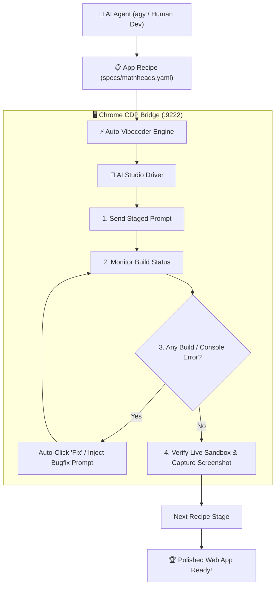

# ⚡ Auto-Vibecoder — Agentic App Factory

> **Autonomous AI-Driven Web App Factory** orchestrating Google AI Studio Apps (`https://aistudio.google.com/apps`) via Playwright CDP, featuring automated self-healing, progressive multi-stage prompting, and live sandbox verification.

[](https://opensource.org/licenses/MIT)
[](https://nodejs.org/)
[](https://playwright.dev/)
[](https://aistudio.google.com/)

---

## 🌟 Why Auto-Vibecoder?

Building web applications with AI code generators usually requires sitting in front of a browser, typing prompt after prompt, and manually fixing errors. **Auto-Vibecoder** turns Google AI Studio into an autonomous software factory:

1. **Zero Cloud Hosting Cost:** Leverages Google AI Studio's built-in live sandbox, bundler, and Cloud Run runtime for free.
2. **Self-Healing Engine:** Automatically detects build failures, clicks the `"Fix with Gemini"` button, captures console errors, and repairs the codebase without human intervention.
3. **Agent-Native Architecture:** Designed for AI agents like **`agy` (Antigravity)**, Claude Code, and Cursor to read, execute, and extend out-of-the-box.
4. **Declarative Recipes (`specs/*.yaml`):** Break down entire PRDs into staged execution pipelines (`v1` Foundation ➔ `v2` Mechanics ➔ `v3` Juice & SFX ➔ `v4` Polish).

---

## 🏗️ System Architecture



---

## 🚀 Quickstart

### 1. Installation
```bash
git clone https://github.com/tontonyuta/auto-vibecoder.git
cd auto-vibecoder
npm install
```

### 2. Launch Chrome with CDP
You must log in to Google AI Studio once in this Chrome instance:
```bash
npm run chrome:debug
```

### 3. Verify Connection
```bash
npm run check
```

### 4. Run a Vibecoding Recipe
```bash
# Run the MathHeads Speed Math trainer recipe:
npm run vibecode:mathheads

# Run the MathTeach Studio 12 teacher platform:
node auto_mathteach_pipeline.js

# Or run from your own raw idea:
npm run vibecode:idea "Clone game 2048 nhưng phong cách Neon Synthwave"
```

---

## 📐 Featured Project: MathTeach Studio 12

An interactive web application & extension for high school math teachers (Vietnamese Curriculum GDPT 2018 - Toán 12 Mới):
- **Aesthetic:** Modern Linear/Raycast design, zero "AI slop", sharp 1px borders, deep dark `#09090b` palette, 100vh locked layout.
- **Module 1 (Giải Tích 12):** Vector SVG Bảng biến thiên chuẩn SGK, Đồ thị 2D, hỗ trợ hàm bậc 3, phân thức bậc 1/1 và **phân thức bậc 2/1 có Tiệm cận xiên (TCX)**, xuất SVG/PNG/LaTeX tkz-tab.
- **Module 2 (Thống Kê Ghép Nhóm):** Tự động tính mẫu số liệu ghép nhóm $[a_i; a_{i+1})$, giá trị đại diện $c_i$, tần số tích luỹ $cf_i$, trung vị, mốt, tứ phân vị $Q_1, Q_3$, khoảng tứ phân vị $\Delta_Q$, phương sai & kèm **Lời giải chi tiết từng bước** chuẩn SGK.
- **Module 3 (Xác Suất Sơ Đồ Cây):** Sơ đồ cây kỹ thuật 2 tầng vector SVG, tính xác suất toàn phần & công thức Bayes với các bài toán mẫu thực tế (xét nghiệm bệnh, kiểm tra linh kiện, xạ thủ).
- **Module 4 (Không Gian Oxyz 3D):** Trục toạ độ Oxyz, hộp chiếu vuông góc điểm $M(x,y,z)$, mặt phẳng $(\alpha)$, mặt cầu $(S)$, đường thẳng $(d)$, tích có hướng, tích vô hướng và khoảng cách.
- **Presenter Mode:** Phím tắt bàn phím (1, 2, 3, 4, Z, F), nút copy nhanh bài giảng vào Word/OneNote/PowerPoint.

---

## 🧠 Agent-Native Design (`AGENTS.md` & `skills/`)

This repository is built from the ground up for autonomous agents. If an AI coding agent (`agy`, Cursor, Windsurf) opens this workspace, it can immediately read:

1. **[`AGENTS.md`](AGENTS.md):** The machine-readable operational manual guiding agents on how to execute, heal, and add features.
2. **Specialized Skills Library (`skills/`):**
   * [`skills/ui-ux-design-pro.md`](skills/ui-ux-design-pro.md): Rules for high-conversion, modern Dark Theme, responsive layouts (375px - 1920px), and game feel (canvas particles, screen shake, combo multipliers).
   * [`skills/performance-optimization.md`](skills/performance-optimization.md): Guidelines for zero-latency Web Audio API synthesis and 60fps canvas pooling.
   * [`skills/web-security.md`](skills/web-security.md): Strict security policies preventing `eval()`, securing client state, and avoiding sandbox crashes.
   * [`skills/prompt-architect.md`](skills/prompt-architect.md): The 4-stage progressive delivery formula to prevent model truncation.

---

## 📝 Creating New Recipes (`specs/`)

Define any new application in a simple YAML file:

```yaml
name: "flappy-bird-cyberpunk"
title: "Cyberpunk Flappy Jet"
stages:
  - id: "v1-base"
    title: "V1: Canvas Engine & Physics"
    prompt: "Tạo game Flappy Bird phong cách Neon Cyberpunk bằng HTML5 Canvas và React..."
  - id: "v2-mechanics"
    title: "V2: Highscore, Laser Obstacles & Audio"
    prompt: "Thêm chướng ngại vật laser, hiệu ứng âm thanh Web Audio API..."
```

Run your new recipe:
```bash
node bin/vibecoder.js run ./specs/flappy-bird-cyberpunk.yaml
```

---

## 📄 License
MIT © [tontonyuta](https://github.com/tontonyuta)
